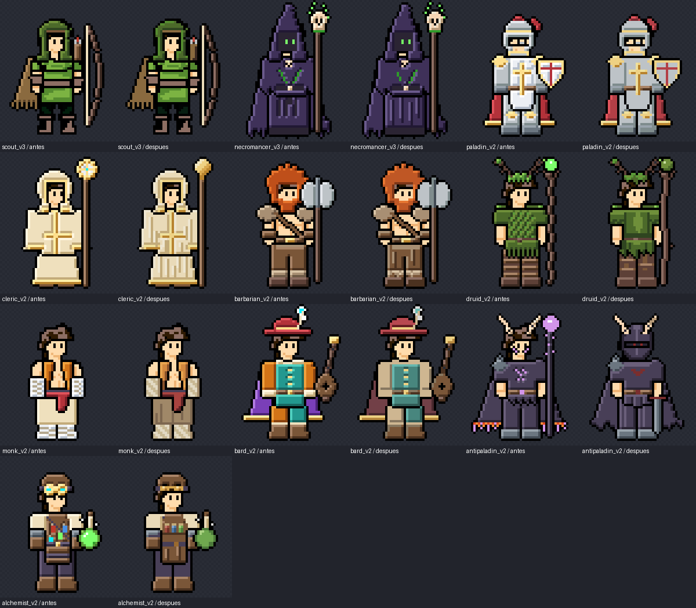
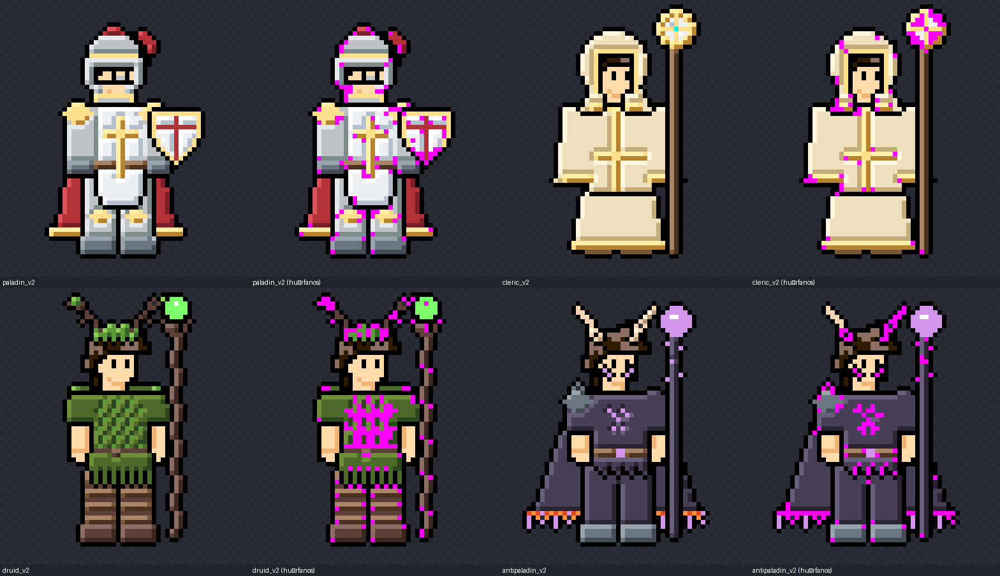
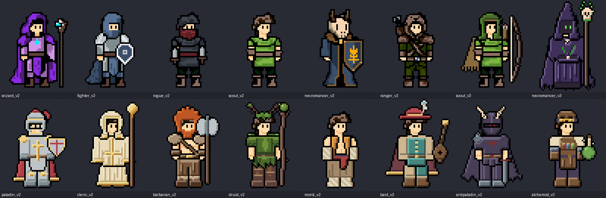
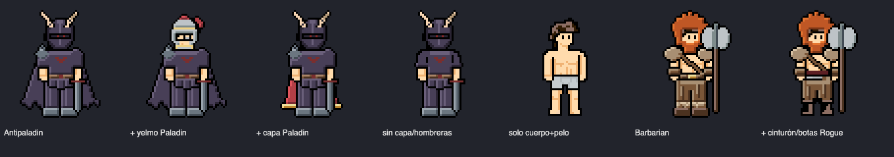

# Auditoría de las propuestas de clase — 8 oct 2026

Alcance: las 16 propuestas de rediseño de la Forja de Clases
(`public/admin-tools/character_builder.html`, constante `PROPOSALS`).

- **6 dibujadas a mano** (Wizard, Fighter, Rogue, Scout v2, Necromancer v2, Ranger) → **referencia de estilo, no se han tocado**.
- **10 generadas** (Scout v3, Necromancer v3, Paladin, Cleric, Barbarian, Druid, Monk, Bard, Antipaladin, Alchemist) → auditadas y pulidas.

Las versiones originales de las 10 siguen en el repo `Editor-pixel-character` (commit `cb9b50e`).

---

## 1. Por qué "se veían IA"

Lo he medido sobre el composite 64×64 de cada clase, comparando con las 6 dibujadas a mano:

| Métrica | Mano (ref.) | Generadas antes | Generadas después |
|---|---|---|---|
| Colores en el sprite | **13,2** | 22,7 | 17,4 |
| Píxeles huérfanos (sueltos dentro de una masa) | **11** | 83 | 27 |
| Píxeles "neón" (saturados y brillantes) | **12 %** | 14 % | 8 % |
| Blanco puro en ropa | **0,5 %** | 1,4 % | 0 % |
| Familias de tono | **2,7** | 4,0 | 3,4 |
| Dirección de la luz | **frontal suave** | lateral fuerte (izq.) | frontal |

Los cinco patrones que delataban la generación:

1. **Texturas mecánicas que se repiten**: la túnica del Druid con un patrón diagonal repetido (`fbg fbg fbg`), los bajos en peine perfecto (`XdXdXd`) en Druid y Antipaladin, y el bastón del Druid en zigzag cada 8 píxeles.
2. **Bandas horizontales paralelas** en piernas y botas (Druid, Barbarian, Alchemist). En tus sprites las arrugas son verticales y de largo irregular.
3. **"Confeti" de color**: píxeles sueltos de 4-5 tonos distintos (viales del Alchemist, runa del pecho y cara del Antipaladin, gema del Cleric).
4. **Acentos neón ajenos a la paleta**: orbes verde y lila, gafas cian, pluma cian.
5. **Masas planas sin volumen**: la túnica del Cleric, el pantalón del Monk y el bajo del Necromancer v3, con una runa estampada encima.

---

## 2. Guía de estilo (extraída de tus clases dibujadas a mano)

1. **Paleta corta**: 12-15 colores por sprite, en tonos apagados y terrosos.
2. **Luz frontal suave**. El volumen sale de pliegues verticales de largo irregular, no de una cara iluminada y otra en sombra.
3. **Contorno exterior negro de 1px.** Las líneas interiores van en el tono oscuro del propio material.
4. **Brillos en grupos de 2-4px**, nunca en píxeles sueltos (salvo los ojos).
5. **Sin blanco puro.** El tono más claro es un gris o crema cálido.
6. **Un solo acento saturado por clase**: el emblema dorado del Necromancer v2 o la máscara roja del Rogue.
7. **Asimetría**: capa a un lado, correa en diagonal, arma en una sola mano.
8. **Nada de patrones repetidos** con un periodo fijo.

---

## 3. Cambios por clase

| Clase | Problema | Arreglo |
|---|---|---|
| **Druid** | Túnica con patrón diagonal; bajo en peine; bastón en zigzag periódico; orbe neón plano; piernas a 4 bandas | Luz frontal con una hoja en el pecho, hojas solo en hombreras y bajo; bajo dentado irregular; bastón nudoso con quiebros irregulares; orbe de musgo con volumen; vendas asimétricas |
| **Antipaladin** | Era un brujo (sin armadura): ruido lila en cara y pecho, llamas punteadas, orbe neón | **Caballero oscuro**: yelmo cerrado con visor y ojos rojo apagado, emblema de cuernos, faldar de 3 placas, capa rasgada irregular, mandoble con la punta al suelo |
| **Cleric** | Túnica plana, gema cian "estrella" con ruido | Pliegues verticales de largo variable con filo de luz; disco solar dorado sombreado |
| **Monk** | Vendas a rayas blanco/gris (patrón de cuadros), pantalón crema plano, faja roja neón | Vendas diagonales en crema cálido; pantalón tierra con pliegues (separa materiales); faja carmesí apagada |
| **Bard** | 7 familias de tono (naranja, verde azulado, morado, rojo, amarillo, cian…) | 2 complementarios apagados (rojo del sombrero + verde azulado del jubón), mangas crema, capa granate y pluma blanca rota |
| **Necromancer v3** | Bajo plano con runa estampada | Pliegues orgánicos |
| **Barbarian** | Botas a 3 bandas planas | Puños de piel con mechones irregulares; pliegues en el pantalón |
| **Alchemist** | Viales "confeti", gafas cian, matraz neón, delantal a rayas | 3 viales limpios en bandolera, gafas ámbar en la frente, matraz apagado y sombreado, delantal con pliegues |
| **Paladin, Scout v3** | Blanco puro, píxeles sueltos en la armadura | Solo pasada automática (paleta y ruido) |

Todas pasan además por una pasada automática: neón y blanco atenuados, tonos casi idénticos fusionados y ruido aislado eliminado.

---

## 4. Lo que queda para tu mano

Esto es criterio de artista; no lo he forzado:

- **Paladin**: sigue rígido y simétrico, con brillos de 1px en la armadura. Le vendría bien una capa o un tabardo asimétrico y brillos agrupados.
- **Paladin y Cleric** son mucho más claros que el resto. En la fila completa pesan demasiado: conviene bajar un escalón de valor en sus blancos.
- **Barbarian**: el pelo naranja es el acento más saturado de toda la familia. Puede quedarse si es intencionado.
- **Alchemist**: las gafas en la frente se leen poco. Está fuera de canon, así que es baja prioridad.
- **Sorcerer**: es la única clase canónica sin propuesta.
- Todas comparten pose (brazos relajados). Una pose de arma por familia (acorazado, túnica, común) daría más carácter.

---

## 5. Capas y cosméticos (actualización)

Decisión: **9 huecos estándar** y cosméticos **solo para su propia clase**.

| Hueco | Clave interna | Notas |
|---|---|---|
| Cabeza | `capucha` | casco, capucha, sombrero (los cuernos van con el yelmo) |
| Torso | `torso` | camisa, armadura, túnica larga |
| Hombreras | `hombreras` | también estolas o mantos de piel |
| Cinturón | `cinturon` | también fajines que cuelgan |
| Guantes / brazaletes | `brazaletes` | |
| Piernas | `piernas` | |
| Botas | `botas` | también vendas de tobillo |
| Capa | `capa` | detrás del cuerpo |
| Arma / Escudo | `arma` / `escudo` | |
| *Apariencia* | `pelo`, `barba` | no se compran como ropa |

**Separación hecha en las 16 propuestas.** Cinturones, botas y hombreras salen de torso y piernas. El pelo y la barba del Barbarian pasan a apariencia y la estola del Necromancer v2 a hombreras.

Debajo de cada pieza retirada, la prenda continúa solo si realmente sigue por encima o por debajo; si no, se ve el cuerpo.

Comprobación: con todas las piezas puestas, cada clase queda idéntica píxel a píxel a como estaba. Solo cambian 2 píxeles en total (1 en Fighter y 1 en Necromancer v2), donde ahora la hombrera tapa la punta de un mechón.

**En el juego.** La Forja publica las piezas por separado y el avatar las compone en tiempo real con los cosméticos equipados. Prueba: la composición del juego es idéntica a lo que hornea la Forja en las 4 clases probadas.

**Pendiente:**
- Las clases se ven por capas en el juego cuando se adopta su propuesta, se marca «En el juego» y se publica. Hasta entonces se usa el sprite plano.
- Wizard, Fighter y Rogue "construidas" usan aún sus capas antiguas, con el cinturón dentro del torso. Al adoptar sus propuestas v2 pasan al sistema nuevo.
- Falta una tienda de trajes completos: hoy solo hay cosméticos sueltos del Pixel Studio.
